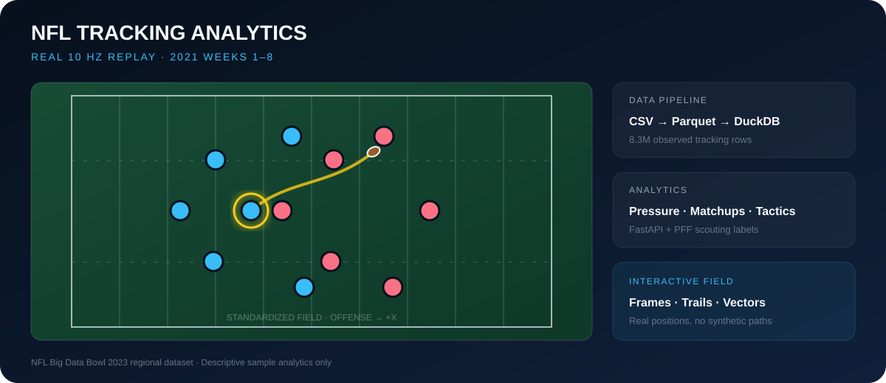

# NFL Tracking Analytics
Local-first NFL Big Data Bowl dashboard with a FastAPI analytics API and real 10 Hz SVG play replay. 
Internal setup and data documentation: `.hackathon/INSTALACION.md`, `etl/README.md`, and `docs/DATA_DICTIONARY.md`.
A play lasts seconds; here, 8.3 million tracking records reveal how 22 players turn every instant into strategy.
